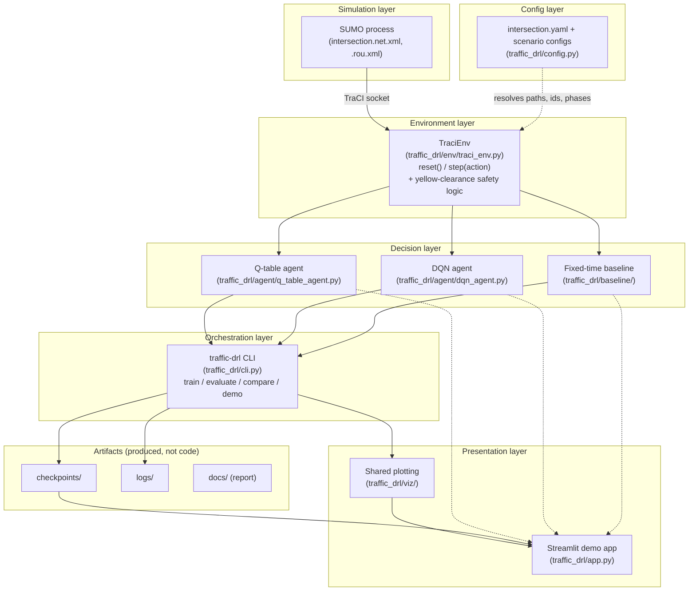

# System Architecture

This diagram shows the layered architecture of the `traffic_drl` product: a
strict dependency chain where each layer only depends on the layer directly
beneath it. This is what makes the environment swappable (different
intersections via config) and the agent swappable (Q-table now, DQN later)
without touching the layers around them.

## Layer summary

- **Simulation layer** — SUMO owns the actual traffic physics as a separate
  headless process. Nothing in the Python code simulates traffic itself.
- **Config layer** — `intersection.yaml` and the scenario configs are what
  make the environment config-driven: file paths, traffic-light id, phase
  indices, and approaches all live here, not hardcoded in Python.
- **Environment layer** — `TraciEnv` is the *only* thing that talks to SUMO
  directly (via TraCI). It exposes a standard `reset()`/`step(action)`
  contract so every layer above it never needs to know SUMO exists. The
  yellow-clearance safety rule (no direct green-to-green switch) lives here,
  since it's a property of the environment's transition, not something each
  agent has to remember.
- **Decision layer** — the Q-table agent, DQN agent, and fixed-time baseline
  all consume the same environment contract, so they're interchangeable from
  the orchestration layer's point of view. This is what makes
  `traffic-drl compare` an apples-to-apples comparison.
- **Orchestration layer** — the CLI is the only layer that "knows about
  everything": it wires config + environment + agent/baseline together for a
  given command (`train`, `evaluate`, `compare`, `demo`).
- **Presentation layer** — `viz/` is shared plotting code consumed by both
  the CLI's saved report figures and the live Streamlit app, so there's one
  implementation of "plot the reward curve," not two.
- **Artifacts** — checkpoints, logs, and report docs are what training and
  evaluation *produce*; they sit outside the package itself.
